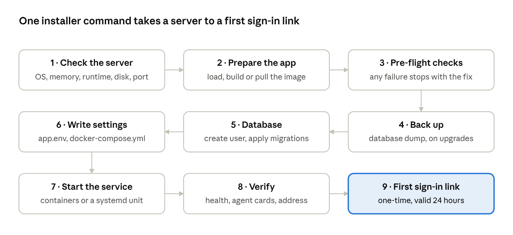

# Ituti AI Assurance — Admin Guide

Oct 29, 2026 · @Nayan

## Who this guide is for

This guide is for the people who run the platform: Ituti administrators on the cloud service, the IT team that installs it on-premises, and client admins who manage their own organisation. Day-to-day assessment work is in the *User Guide*; how the system is built is in the *Design Document*.

| Role | Where | Can |
| --- | --- | --- |
| **Ituti admin** | Whole installation | Add clients, invite the Ituti team, set plans and AI switch-on, see spend and budgets, the System page, sign-in links |
| **Ituti assessor** | Assigned clients | Assess and edit every system of those clients |
| **Client admin** | One organisation | People, teams, API keys, connected AI applications, every system |
| Contributor, Viewer, Team lead, Team member | One organisation | See the *User Guide* |

The administration area is reached from the top bar: **Clients**, **Ituti team**, **Spend** and **System**. Only Ituti admins see it.

> **Ground rule for secrets:** passwords, API keys and tokens go in the server's environment (hPanel on Hostinger, `ituti.conf` and `app.env` on-premises). Never in the repository, a ticket or a chat.

## Clients and people

### Add a client

Under **Clients**, use **Add a client** with the client organisation's name. Then open the client and use **Invite someone from** *the client* to invite its first client admin; from there, people, teams and systems are theirs to set up. **Delete client** removes a client and everything in it: use it with care.

### Client settings

On the client's page, **Client settings** holds:

- **Client name.**
- **AI assistance** on or off. When on, the assessment agent and AI review send the client's documents and assessment text to Anthropic's API. Switch it on only once the client has agreed. When off, the agent refuses to run and everything is done by hand.
- **Plan:** *Per assessment*, *Enterprise (flat fee)* or *Internal or trial (not billed)*. The plan drives how usage is reported for billing.

### People and invitations

- **Ituti team** (admin top bar): invite colleagues as Ituti admins or assessors, and assign assessors to clients (they appear under *Ituti assessors on this client*).
- **People** (client navigation): client admins invite members of their organisation, choose their role and disable leavers. A disabled user can no longer sign in; their history stays.
- **Teams**: create teams, add members, choose a lead and the systems the team covers.
- **Activity**: the audit log of who changed what, and when.

### API keys

A client API key lets a machine act for that client: watsonx Orchestrate calling the A2A agents, or an MCP client that cannot use OAuth. Under the client's page enter a name (for example *watsonx Orchestrate production*) and select **Create key**. The full key, starting `ita_`, is shown **once**; afterwards only its prefix is listed. Store it in the calling system's secret store and revoke it from the same list when it is no longer needed.

### Connected AI applications

People can connect Claude, watsonx Orchestrate or another MCP client to the platform at `<address>/api/mcp` by signing in and approving it (OAuth). Each connection appears under **Connected AI applications** with who approved it and when it was last used. **Disconnect** revokes its tokens immediately. Access tokens last one hour and are refreshed for up to 30 days of use.

## AI spend and budgets

Every call to Claude is recorded, whichever path made it: the assessment crew, the A2A agent endpoints, evidence review or MCP. Each record has the client, AI system, run, agent, model, tokens and estimated cost. No external control plane is needed.

The **Spend** page shows:

- this month's spend and a forecast for the month;
- daily spend;
- breakdowns **By client**, **By agent**, **By model** and **By source**;
- a **CSV export** of every call, for your FinOps tools.

**Budgets.** Set a monthly budget for the whole installation and, optionally, for each client. Administrators (and that client's admins) are emailed when spend reaches the alert level (80% by default) and when the budget is reached. With **hard stop** on, new AI work pauses until the budget is raised or the month turns; work already running finishes.

**Prices.** Costs are estimated at Anthropic list prices per million tokens:

| Model | Input | Output | Cache write | Cache read |
| --- | --- | --- | --- | --- |
| Claude Opus 5.5 | $4 | $20 | $5 | $0.20 |
| Claude Sonnet 5.5 | $2 | $10 | $2.50 | $0.20 |

Set `ANTHROPIC_PRICES` to your negotiated rates. A cheaper model for the evidence reader (`ANTHROPIC_MODEL_READER`) is the simplest way to cut cost.

## The System page

**System** shows how this installation is set up, without revealing any secret:

| Row | Shows |
| --- | --- |
| Version | Application version, cloud or on-premises, Node.js version |
| Address | The public address used in links |
| Database | Server version and the migrations applied |
| Document storage | Folder, free space (warns under 5 GB), number and size of documents |
| Email | Mail server, or *No mail server* |
| AI (Claude) | Agent model, gateway or direct, outbound proxy |
| Cost estimates | List prices or custom prices |
| AI budget | This month's spend against the overall budget |
| MCP server | The MCP address and how clients sign in |
| Control plane | Whether traces go to watsonx Orchestrate |
| Self sign-up | Open at `/register`, or invitation only |
| Usage | Clients and active users |

It also lists every database migration with the date it was applied.

**One-time sign-in link.** For a user who cannot receive email (or an installation with no mail server), enter their email and select **Make link**. The link works once, within 60 minutes; share it privately. Settings are changed in the server's environment, not on this page.

## Connecting IBM watsonx Orchestrate

There are three independent ways to use the platform with Orchestrate. Use any combination.

### 1. Register the agents (A2A)

The platform publishes a main agent and seven specialists over A2A 0.3.0:

| Agent | Endpoint |
| --- | --- |
| Main agent (coordinator) | `<address>/api/a2a`, card at `/.well-known/agent-card.json` |
| Evidence reader, model researcher, risk classifier, controls assessor, documentation writer, conformity writer, source checker | `<address>/api/a2a/agents/<specialist>` |

1. Create a client API key (see *Clients and people*).
2. In Orchestrate, add each as an **external A2A agent** (protocol 0.3.0) with the key as bearer token. The ready-made ADK files are in the repository under `ibm/` and `ibm/specialists/`; put the key in Orchestrate's connection, not in the files.
3. Make sure **AI assistance** is on for that client, or the agent refuses to run assessments.

### 2. Connect over MCP

Add `<address>/api/mcp` as an MCP server (`ibm/mcp/ituti-assurance-mcp.yaml` has the OAuth connection steps). Users sign in and approve; their own rights apply. Fifteen tools are available, from `list_systems` to `get_ai_spend`.

### 3. Send traces

Set these on the server and restart; each specialist's runs, latency and token use then appear against its own Agent ID in Orchestrate:

| Setting | Value |
| --- | --- |
| `ORCHESTRATE_INSTANCE_URL` | `https://api.<region>.watson-orchestrate.cloud.ibm.com/instances/<instance-id>` |
| `ORCHESTRATE_API_KEY` | An API key for that instance |
| `ORCHESTRATE_TENANT_ID` | `<account-id>_<instance-id>` |
| `ORCHESTRATE_AGENT_IDS` | `coordinator=<id>,reader=<id>,research=<id>,classify=<id>,controls=<id>,docs=<id>,conformity=<id>,checker=<id>` |
| `ORCHESTRATE_AUTH` | `iam` (IBM Cloud, default), `mcsp` (AWS) or `apikey` |

The System page's *Control plane* row confirms traces are flowing. Spend is still tracked on the Spend page either way.

## Running the cloud service

The Ituti cloud service runs at **assurance.ituti.tech** as a Node.js website on Hostinger, built from the `main` branch of the GitHub repository.

| Part | How it is set up |
| --- | --- |
| Build and deploy | Node 22, `npm run build`, `npm start`. Every push to `main` rebuilds and redeploys automatically |
| Database | MySQL on the same account, reached at `127.0.0.1`; settings written by Hostinger |
| Documents | `DATA_DIR` outside the website folder, so rebuilds never touch uploaded evidence |
| Email | Sent from `assurance@ituti.tech` through Hostinger's mail server |
| Settings | hPanel → Websites → assurance.ituti.tech → Node.js → Environment variables |

**Releasing a change:** merge to `main`, then watch the build in hPanel (or with the Hostinger connector's deployment status). A failed build leaves the previous version running. After a build, check `/api/health` returns OK.

**Database changes** are versioned migrations applied automatically at start-up under a database lock, so several app processes can start together safely. Migrations are only ever added, never edited.

**Changing a setting:** edit it in hPanel. Settings read at build time (such as the public address) need a new build; the rest take effect on restart.

**Before a release,** run the test suites: `npm test` (unit) and `npm run build && npm run test:e2e` against a test database (`TEST_DATABASE_URL`), which creates and drops its own database each run.

## Installing on-premises

The on-premises package installs the complete platform on your own servers: the web application, the assessment crew and the A2A and MCP endpoints. Its deployment agent creates the database, the application user and every table, configures and starts the service, checks it and gives you a first sign-in link.

### What you need

|  |  |
| --- | --- |
| Server | Linux (x86-64 or ARM64), 2 CPUs, 4 GB memory, 10 GB disk plus document storage |
| Runtime | Docker Engine 24+ with the compose plugin (recommended), or Node.js 22+ where containers are not allowed |
| Database | MySQL 8.0+ or MariaDB 10.6+, or a bundled MariaDB container (Docker only) |
| Storage | A persistent, backed-up folder for evidence documents (local disk, SAN or NFS) |
| Network | HTTPS for users; outbound HTTPS to Anthropic or your API gateway, directly or through a proxy |
| Optional | Mail server (SMTP), Anthropic API key, IBM watsonx Orchestrate |

### Install in three steps

```bash
tar -xzf ituti-ai-assurance-onprem-<version>.tar.gz && cd ituti-ai-assurance-onprem-<version>
cp ituti.conf.example ituti.conf && chmod 600 ituti.conf && vi ituti.conf
./install.sh install --config ituti.conf
```

Run it on the server, or from your workstation with `DEPLOY_HOST` set: the installer then copies itself over SSH (key-based login, an account with sudo) and runs there.



Every step can be run again safely. The pre-flight checks cover settings, the database connection and version, storage (writable, free space), the mail server login and the AI key and its reachability. With `DB_ADMIN_USER` set (or the bundled database), the installer creates the database (utf8mb4) and an application user with rights on that database only; otherwise ask your DBA to create both first. It also creates the first administrator and the overall AI budget, and keeps a copy of itself and your settings in `DEPLOY_DIR` for later commands.

**Security defaults:** the app runs unprivileged (container user 10001, or the `ituti` service account) and can write only to the document folder, its logs and its cache. `ituti.conf` and `app.env` are readable by administrators only; generated secrets live in `DEPLOY_DIR/secrets.env`. Self-service sign-up is off; users are invited.

## Running it on-premises

All commands run on the server as `sudo /opt/ituti-assurance/installer/install.sh <command>` (or from your workstation with `DEPLOY_HOST` set).

| Command | Does |
| --- | --- |
| `status` | Installed version and service health |
| `check` | All pre-flight checks, changing nothing |
| `backup [--with-files]` | Database dump (gzip SQL, restorable with `mysql`) and settings into `BACKUP_PATH`; with `--with-files`, the documents too |
| `install` (from a newer package) | Upgrade: backs up, installs the new version, applies new migrations |
| `rollback` | Back to the previous version |
| `admin-link [--email you@bank.com]` | A new one-time sign-in link |
| `doctor [--ai]` | Diagnoses problems; with `--ai`, Claude suggests fixes (findings sent with passwords and keys removed) |
| `restart`, `stop`, `logs` | Service control |
| `uninstall` | Removes the service; keeps the database, documents and backups |

### Upgrading

1. Unpack the new package next to the old one.
2. Run `./install.sh install` from it. The installer finds your settings in `DEPLOY_DIR`, backs up the database, installs the new release alongside the old one, applies any new migrations and verifies the service.
3. Check the System page shows the new version.

### Rolling back

`rollback` switches back to the previous release. Migrations only ever add, so the previous version usually runs on the upgraded database; if a release notes that a migration changed data, restore the pre-upgrade backup as well.

### Backups

Schedule `backup --with-files` nightly (for example with cron) and copy `BACKUP_PATH` off the server. A restore is the dump loaded with `mysql` plus the documents folder put back. Test a restore at least once a quarter.

### Changing a setting

Edit `DEPLOY_DIR/ituti.conf` and run the installer again; it rewrites `app.env` and restarts the service.

## Configuration reference

On-premises these are set in `ituti.conf`; on the cloud service, as environment variables in hPanel (the application names are given where they differ).

| Setting | Purpose | Default |
| --- | --- | --- |
| `DEPLOY_HOST`, `DEPLOY_SSH_USER`, `DEPLOY_SSH_PORT`, `DEPLOY_SSH_KEY`, `DEPLOY_SUDO` | Install on a remote server over SSH; empty installs locally | local, 22, sudo on |
| `DEPLOY_DIR` | Application, settings and logs | `/opt/ituti-assurance` |
| `RUNTIME` | `docker` or `node` | docker |
| `APP_URL` (app: `NEXTAUTH_URL`) | Public address used in links and agent cards | required |
| `APP_PORT`, `BIND_ADDRESS` | Port and interface | 3000, 127.0.0.1 |
| `TLS_CERT_FILE`, `TLS_KEY_FILE` | Serve HTTPS directly (Docker) | empty |
| `DB_MODE` | `external` or `bundled` | external |
| `DB_HOST`, `DB_PORT`, `DB_NAME`, `DB_USER`, `DB_PASSWORD` (app: `DATABASE_URL`) | Database connection | 3306, ituti\_assurance |
| `DB_ADMIN_USER`, `DB_ADMIN_PASSWORD` | Lets the installer create the database and user | empty |
| `DB_SSL`, `DB_SSL_CA` | TLS to the database | off |
| `STORAGE_PATH` (app: `DATA_DIR`) | Evidence documents | `/srv/ituti-assurance/data` |
| `BACKUP_PATH`, `STORAGE_MIN_FREE_GB` | Backups; minimum free space | `/srv/ituti-assurance/backups`, 5 |
| `ADMIN_EMAIL`, `ADMIN_NAME` (app: `BOOTSTRAP_ADMIN_EMAIL`) | First administrator | required |
| `SELF_REGISTRATION` | `off` or `open` | off on-premises |
| `SMTP_HOST`, `SMTP_PORT`, `SMTP_USER`, `SMTP_PASSWORD`, `EMAIL_FROM` | Outgoing email | none; 587 |
| `ANTHROPIC_API_KEY` | Turns the agents on | empty (agents off) |
| `ANTHROPIC_BASE_URL` | Your API gateway in front of Anthropic | direct |
| `ANTHROPIC_AGENT_MODEL`, `ANTHROPIC_MODEL`, `ANTHROPIC_MODEL_READER` | Models for the crew, reviews and the evidence reader | Opus 5.5, Sonnet 5.5 |
| `ANTHROPIC_PRICES` | Negotiated prices, JSON per million tokens | list prices |
| `HTTPS_PROXY`, `NO_PROXY` | Outbound proxy | none |
| `MONTHLY_BUDGET_USD`, `BUDGET_ALERT_PERCENT`, `BUDGET_HARD_STOP` | Overall AI budget | none, 80, off |
| `ORCHESTRATE_*` | Traces to watsonx Orchestrate (see above) | off |
| `IMAGE`, `BASE_IMAGE`, `MARIADB_IMAGE`, `CADDY_IMAGE` | Container images | bundled image, node:22-bookworm-slim, mariadb:11.4, caddy:2.8 |
| `MCP_ALLOWED_ORIGINS` | Extra browser origins allowed to call the MCP server | this site, claude.ai, localhost |
| `NEXTAUTH_SECRET` | Session signing secret (generated on-premises) | required in the cloud |

## Troubleshooting

Start with `install.sh doctor` on-premises, or `/api/health` and the System page anywhere.

| Symptom | Likely cause | Fix |
| --- | --- | --- |
| Users get no sign-in email | No mail server, or SMTP login refused | Check the System page's *Email* row and `install.sh check`; meanwhile issue one-time links from the System page |
| The agent button is greyed out | No API key, AI assistance off for the client, or the budget's hard stop reached | Set `ANTHROPIC_API_KEY`; switch AI assistance on in Client settings; raise the budget on Spend |
| Assessment runs fail at once | Anthropic not reachable from the server | Check outbound HTTPS, `HTTPS_PROXY` and `ANTHROPIC_BASE_URL`; `install.sh check` tests reachability |
| A run shows as stale | The process running it restarted | Select *Run again*; finished proposals are kept |
| Upload refused | File over 25 MB, unsupported type, or storage full | Split the file; check *Document storage* on the System page |
| Orchestrate cannot call the agents | Missing or revoked API key, or AI off for the client | Create a new key; check the client's AI switch |
| An MCP client in a browser is refused | Its origin is not allowed | Add it to `MCP_ALLOWED_ORIGINS` |
| Health check fails after an upgrade | Database or storage not reachable | `install.sh logs`; if needed `install.sh rollback` |
| Cloud build failed | Build error in the latest commit | Read the build log in hPanel; the previous version keeps running until a build succeeds |

**Getting help.** `install.sh doctor --ai` asks Claude to suggest fixes from the findings, with passwords and keys removed before anything leaves the server. For anything else, contact Ituti with the output of `install.sh status` and `install.sh doctor`.
