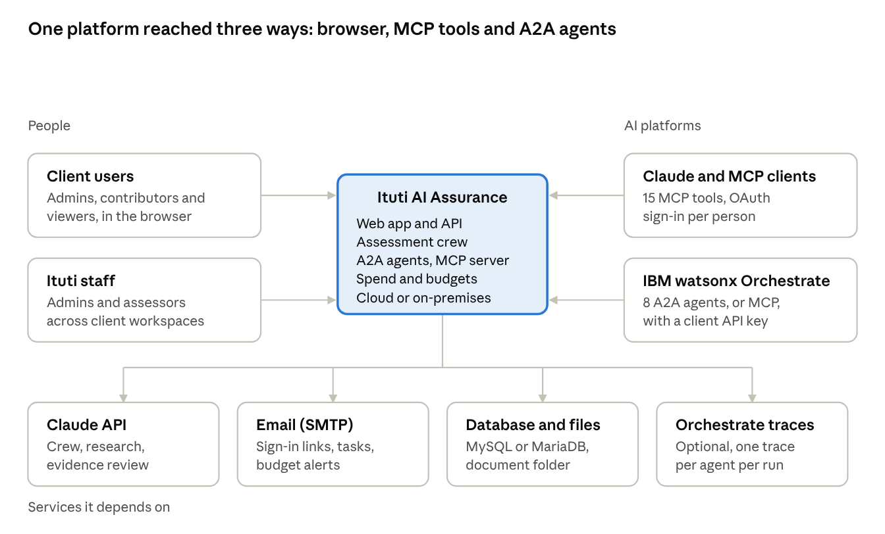
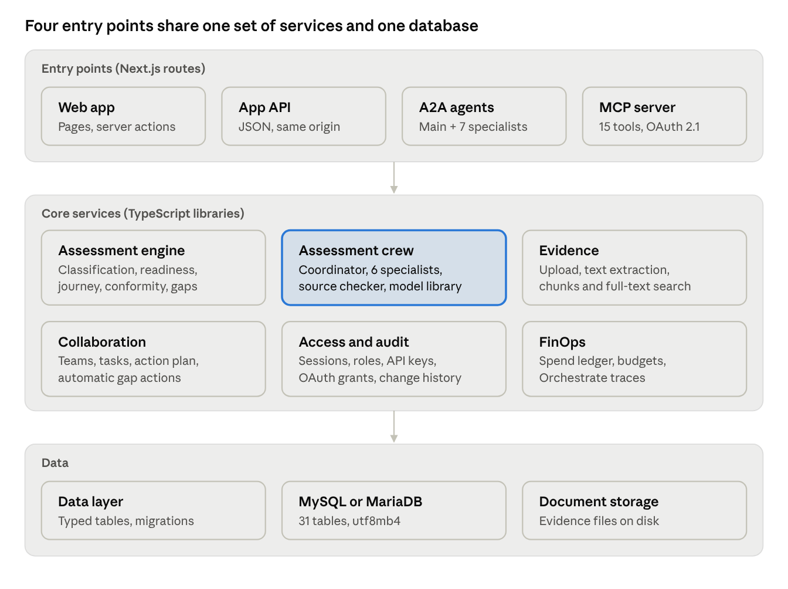
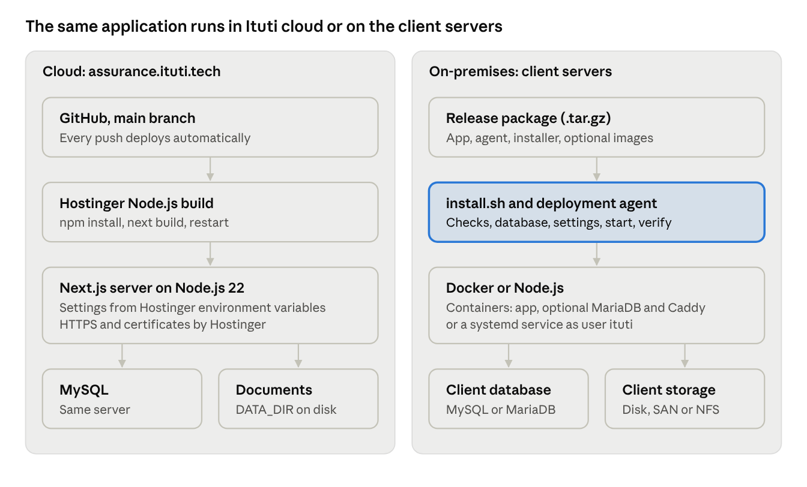
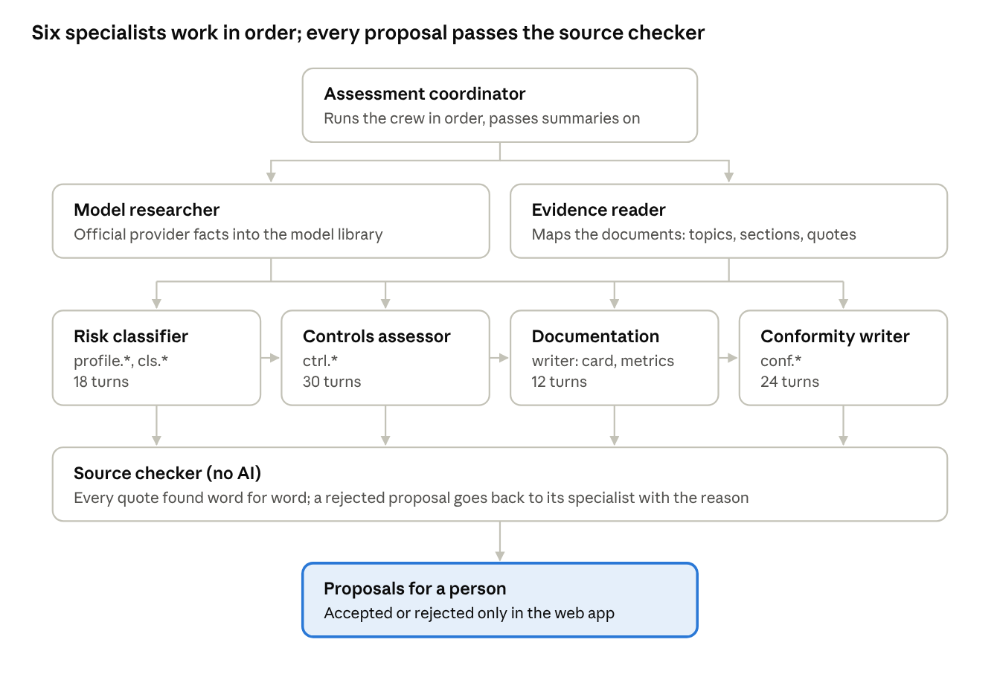
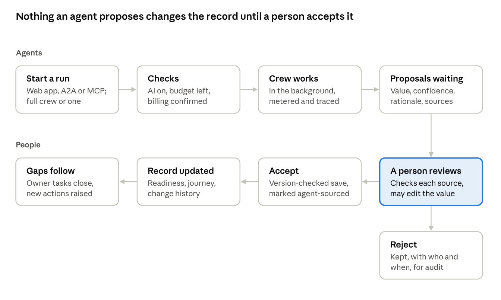
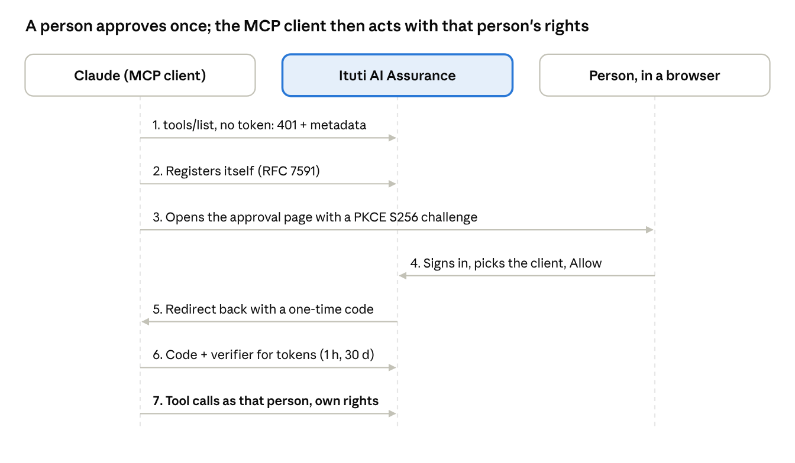
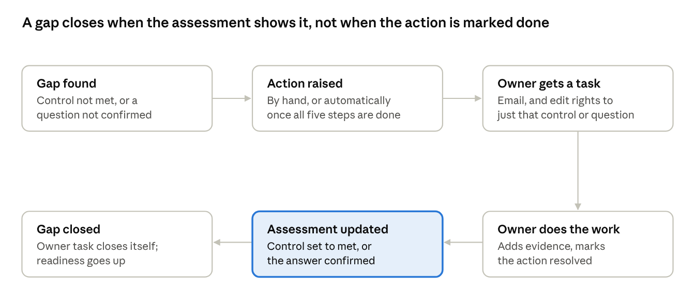

# Ituti AI Assurance: Design Document

Oct 29, 2026 · @Nayan

Ituti AI Assurance is a multi-tenant web platform that inventories AI systems, classifies them under the EU AI Act and assesses them against UK requirements, ISO/IEC 42001 and the NIST AI RMF. A crew of specialist Claude agents pre-fills each assessment from the client's evidence, a person reviews every answer, and the same capabilities are open to other AI platforms through A2A agents and an MCP server.

## At a glance

People use the web app; AI platforms use the same capabilities as MCP tools or A2A agents, always on behalf of one client organisation. Claude calls go to Anthropic (or a gateway), and traces go to watsonx Orchestrate only when configured.

## Purpose and scope

The platform gives a regulated organisation one record of every AI system it builds or buys, and a defensible, evidence-backed view of how each one meets the EU AI Act and UK expectations. It runs as Ituti's hosted service at assurance.ituti.tech, or on the client's own servers.

| Product | What it does | Main screens |
| --- | --- | --- |
| AI inventory | One record per AI system: purpose, owner, team, business unit, vendor and model, users and people affected, lifecycle | AI inventory, system Profile tab |
| AI risk management | EU AI Act classification (prohibited, high, limited, minimal), inherent risk score, reassessment when the context changes | Classification tab, Risk management |
| AI advisory | A five-step compliance journey with the next step and "why we ask" guidance on every question | Journey bar on each system |
| Conformity assessment | 39 controls across 9 areas, and 38 Article 43 / Annex VI questions in organisational, project and technical parts | Controls and Conformity tabs |
| Audit-ready documentation | Assurance report, Annex IV technical file, model card (shareable), conformity and audit trail, inventory, risk and incident reports, CSV exports | Report, Documents |
| AI incident tracker | Incidents per system with severity, category and regulator-reportable flag; gap actions with owner, department and due date | Monitoring tab, Incident tracker, Action plan |

Around these sit the **assessment crew** of Claude agents that pre-fills assessments, **teams and tasks** for dividing the work, the **gap action plan**, **AI spend tracking with budgets**, and three machine interfaces: **A2A agents**, an **MCP server** and a **REST/JSON API** used by the web app.

**Users:** client admins, contributors and viewers in each client organisation; Ituti admins and assessors across clients; AI platforms acting for them (Claude, IBM watsonx Orchestrate and other A2A or MCP clients).

**Out of scope:** the platform gives an indication, not legal advice; a person always accepts or rejects the agents' proposals; it does not host or monitor the client's AI systems themselves (monitoring readings and incidents are recorded, not collected).

## Architecture

The platform is one Next.js 15 application in TypeScript on Node.js 22, layered so that every entry point uses the same services and the same access checks.

| Component | Responsibility | Main code |
| --- | --- | --- |
| Web app | Server-rendered pages for clients and Ituti staff; forms post to server actions | `src/app`, `src/components` |
| App API | JSON endpoints the editor uses: save with version check, agent runs, proposals, documents, incidents, actions, tasks | `src/app/api` |
| A2A agents | JSON-RPC transport, agent cards, the main assistant and seven specialist executors, database task store | `src/lib/a2a` |
| MCP server | Stateless Streamable HTTP server, 15 tools, 2 prompts, 1 resource; OAuth 2.1 authorisation server | `src/lib/mcp`, `src/lib/oauth.ts` |
| Assessment engine | Control catalogue, classification, inherent risk, readiness, journey, conformity pre-fill, gap finding | `src/lib/assurance.ts`, `journey.ts`, `conformity.ts`, `gaps.ts` |
| Assessment crew | Coordinator, specialists, source checker, model research, metering, tracing | `src/lib/agent` |
| Evidence | Store files, extract text (PDF, Word, Excel, CSV, HTML, text), chunk, search, read | `src/lib/documents.ts` |
| Collaboration | Teams, task scopes, gap action plan, owner tasks, automatic actions | `teamwork.ts`, `tasks.ts`, `plan.ts` |
| Access and audit | Sessions, roles and per-system rights, API keys, OAuth, audit log, field history | `session.ts`, `permissions.ts`, `apikeys.ts`, `history.ts` |
| FinOps | Spend ledger, prices, budgets and alerts, OpenTelemetry export | `spend.ts`, `agent/pricing.ts`, `telemetry.ts` |
| Data layer | Typed table access, filters, transactions, migrations, cascading deletes | `src/data` |

The assessment crew is highlighted because it is the only component that calls Claude for assessments; evidence review and the A2A assistant make single Claude calls of their own, and every call goes through the same metered client.

## Deployment

The same build runs in Ituti's cloud and on a client's own servers; only the settings differ.

**Cloud.** Hostinger Node.js hosting builds and restarts the app on every push to `main` of the GitHub repository; MySQL runs on the same server and documents are kept on its disk.

**On-premises.** The `onprem/` package is a separate deliverable in the same repository: a release tarball with the prebuilt app, the deployment agent, `install.sh`, a runtime Dockerfile and, optionally, the container images for servers without registry access. The client fills in one settings file (`ituti.conf`: server, runtime, address, database, storage, first admin, email, AI, budget, Orchestrate) and runs `./install.sh install`, on the server or from a workstation over SSH.

| Choice | Options |
| --- | --- |
| Runtime | Docker Engine 24+ with compose (recommended), or Node.js 22 as a systemd service for servers without containers |
| Database | The client's MySQL 8.0+ or MariaDB 10.6+ (with TLS if required), or a bundled MariaDB container |
| HTTPS | The client's reverse proxy, or a bundled Caddy container with their certificate |
| Image | Shipped in the package, built on the server from the package, or pulled from a registry |
| Network | Direct to Anthropic, through an API gateway, or through an outbound proxy |

The deployment agent's steps are described in the Admin Guide.

## Data model

All state lives in one MySQL 8 or MariaDB 10.6+ database (31 tables, utf8mb4) plus a document folder. Each AI system's assessment is one JSON document (`ai_systems.data`), so new questions need no schema change; everything that is queried, joined or audited has its own table.

| Domain | Tables | Notes |
| --- | --- | --- |
| Identity and access | `users`, `sessions`, `verification_tokens`, `organizations`, `memberships`, `assessor_assignments`, `system_assignments`, `invitations`, `registrations` | Email magic-link sign-in; client roles per organisation; self-service sign-up |
| AI systems | `ai_systems` | Assessment JSON plus summary columns (tier, risk score, readiness, open incidents) and an optimistic-lock `version` |
| Evidence | `documents`, `document_chunks` | Files on disk under `DATA_DIR/documents/<system>/<document>`; extracted text split into searchable chunks with page or section locators |
| Agent work | `agent_runs`, `proposals`, `model_library` | Run log, per-specialist usage (`usage_detail`), proposals with verified sources, a shared library of researched foundation models |
| Incidents and gaps | `incidents` | `kind` = incident or gap; gap actions carry `gapRef`, owner, department and due date |
| Collaboration | `teams`, `team_members`, `team_systems`, `tasks`, `plan_settings` | Task `scope` names the part of the assessment a member may edit; automatic gap-action settings |
| History and sharing | `system_changes`, `audit_log`, `share_links` | Field-level before/after history; who did what, and through which channel; revocable public model-card links |
| Machine access | `api_keys`, `a2a_tasks`, `a2a_contexts`, `oauth_clients`, `oauth_grants` | Hashed client API keys; A2A task store and conversation memory; OAuth clients and hashed codes and tokens |
| Billing and FinOps | `usage_events`, `ai_spend`, `spend_budgets` | Billable assessments; every model call with tokens and estimated cost; monthly budgets |

**Migrations.** The schema is a numbered list of migrations (`001_core` to `010_oauth`) recorded in `schema_migrations`. The app applies pending ones on first database use under a named lock, so several processes can start together; the on-premises installer applies them ahead of start-up. Migrations are only ever added, never edited.

**Deletion.** Deleting a system, a client or a user cascades in code to every dependent row and the stored files; spend history is kept and unlinked rather than deleted.

## Assessment model

Every system is assessed on one control set mapped to four frameworks at once: the EU AI Act, UK requirements (the AI white-paper principles, FCA Consumer Duty, SM&CR and PRA SS1/23), ISO/IEC 42001 and the NIST AI RMF. Each control carries its references to all four, so one answer serves every framework.

**Controls: 39 in 9 areas.** 20 apply only in some contexts (for example generative AI, high-risk systems or providers), so the applicable set follows the profile and classification. Each control is rated met, partly met, not met or not applicable, with an evidence note.

| Area | Controls |
| --- | --- |
| Governance and accountability | GOV-1 to GOV-6 |
| Risk and impact | RSK-1 to RSK-5 |
| Data | DAT-1 to DAT-5 |
| Documentation and records | DOC-1 to DOC-3 |
| Transparency and explainability | TXP-1 to TXP-4 |
| Human oversight | HUM-1 to HUM-4 |
| Accuracy, robustness and security | TEC-1 to TEC-5 |
| Monitoring and incidents | MON-1 to MON-4 |
| EU conformity and registration | CNF-1 to CNF-3 |

**EU AI Act classification** is computed from eight prohibited-practice screens (Article 5), the Annex III high-risk areas, the Article 6(1) product-safety route, profiling and the Article 6(3) exemption, transparency triggers (Article 50) and general-purpose model status. The result is one of: Prohibited, High risk, Limited risk, Minimal risk, Needs legal review (an "unsure" screen) or Not classified. Confirming the classification snapshots the answers that drove it; a later change to any of them flags the system for reassessment.

**Inherent risk** is a 0 to 100 score from the impact factors (people affected, personal data, scale, autonomy, reversibility), the EU AI Act tier and whether the system is generative or agentic, banded Low, Moderate, Elevated or Severe. **Readiness** is the share of applicable controls met, with partly met counting half.

**The five-step journey** shows where each system stands and what to do next:

1. AI inventory: the 11 inventory details recorded.
2. Prohibited practices scan: all eight screens answered.
3. Risk assessment: tier set, impact factors complete, classification confirmed and unchanged since.
4. Transparency check: triggers recorded, or none confirmed.
5. Conformity assessment: all applicable questions confirmed.

A sixth tile, **Close the gaps**, follows: every control not met and every unconfirmed question becomes a gap in the action plan.

**Conformity assessment: 38 questions** for Article 43 internal control (Annex VI): 5 organisational, 18 project and 15 technical. Answers are pre-filled from the rest of the record where possible and must be confirmed by a person.

## AI agents: the assessment crew

An assessment is done by seven specialist agents under a coordinator, not by one large prompt. Each specialist has its own instructions, tools, fields it may propose, turn limit, model, cost meter, A2A address and, optionally, its own Agent ID in watsonx Orchestrate. A specialist that proposes outside its fields is refused and told which colleague owns them.

The researcher and the reader prepare shared inputs once; the four writers then work in order, each seeing what the ones before it proposed.

| Specialist | Job | Proposes | Tools | Turns | Model |
| --- | --- | --- | --- | --- | --- |
| Model researcher | Looks up what a foundation-model provider publishes, from official sources only, into a shared library | — | Web search and fetch (provider domains) | 6 | Agent model |
| Evidence reader | Reads the client's documents and writes an evidence map: topics, sections and exact quotes | — | List, search, read documents | 14 | Agent model (Sonnet recommended) |
| Risk classifier | System profile and EU AI Act classification | `profile.*`, `cls.*` | Documents, model lookup, propose | 18 | Agent model |
| Controls assessor | Rates each applicable control from the client's own documents | `ctrl.*` | Documents, propose | 30 | Agent model |
| Documentation writer | Model card and monitoring metrics | `card.*`, `metric.*` | Documents, model lookup, propose | 12 | Agent model |
| Conformity writer | Answers the Article 43 / Annex VI questions | `conf.*` | Documents, model lookup, propose | 24 | Agent model |
| Source checker | Verifies every source of every proposal before it is stored | — | Deterministic, no model calls | — | — |

The agent model is `claude-opus-5-5` by default; any specialist can be given another (`ANTHROPIC_MODEL_<SPECIALIST>`). The conversation sent to Claude is cached between turns (prompt caching), which keeps the cost of long runs down.

**Other agents.** The **main A2A agent** (Sonnet) handles portfolio questions, registration, evidence and assessments for platforms such as watsonx Orchestrate. Each specialist is also its **own A2A agent** with its own address, answering in its role: the reader answers from the documents, the researcher looks up a model, the checker verifies a quote, and each writer runs just its own part of the assessment. **Evidence review** is a single Claude call that rates the evidence note of each control as supported, weak or missing.

**The MCP server** is the opposite pattern: its tools use no AI, because the calling client's model (for example Claude) does the reasoning, and only starting an assessment or researching a new model calls the crew.

## How an assessment run works

A run is a background job that turns evidence into proposals; people turn proposals into the record.

1. **Start.** From the Evidence and agent tab, the main A2A agent, a specialist A2A agent or the MCP `start_assessment` tool. Only one run per system at a time; a run with no heartbeat for 4 minutes is marked failed.
2. **Checks.** AI must be switched on for the client; no hard-stop budget may be used up; on the per-assessment plan a new billable assessment needs confirmation (re-runs within 30 days are included).
3. **Research and reading.** The model researcher looks up the foundation models named in the profile (cached for 90 days in the model library). The evidence reader maps the documents.
4. **Writing.** Each writer gets only its own fields with their current values, the profile, the evidence map, model facts and what earlier writers proposed, then proposes values with sources. A proposal for a field that already holds that value is skipped; a newer proposal for the same field supersedes the older one.
5. **Verification.** The source checker finds every document quote word for word and records its page or section; model sources must come from a library entry looked up in this run; a control can only be met or partly met on the client's own documents.
6. **Review.** People see each proposal with its current value, confidence, rationale and sources, accept (optionally editing the value) or reject, one at a time or all high-confidence ones at once. Accepting saves with the record's version, so two people cannot overwrite each other.
7. **Follow-on.** Readiness, the journey and the history update; owner tasks whose gap is now closed close themselves; with automatic actions on, any new gap gets an owner.

Every run is metered per specialist and recorded once as an assessment for billing (re-runs on the same system within 30 days are included).

## Integration interfaces

Other AI platforms reach the platform in two ways: as **agents** to delegate to (A2A) or as **tools** their own model calls (MCP). Both act only on the caller's client organisation.

### A2A agents (protocol 0.3.0)

JSON-RPC 2.0 over HTTPS with `message/send`, `message/stream` (server-sent events), `tasks/get` and `tasks/cancel`; tasks and conversation history are kept in the database per client. Authentication: a client API key as `Authorization: Bearer ita_…` or `x-api-key`.

| Agent | Address | Skills |
| --- | --- | --- |
| Ituti AI Assurance (main) | `/api/a2a` | Portfolio, register a system and evidence, run an assessment (confirms billable runs), results and gaps |
| Evidence reader | `/api/a2a/agents/evidence-reader` | Answers from a system's documents with quotes |
| Model researcher | `/api/a2a/agents/model-researcher` | What a provider publishes about a model |
| Risk classifier | `/api/a2a/agents/risk-classifier` | Runs and reports the profile and classification |
| Controls assessor | `/api/a2a/agents/controls-assessor` | Runs and reports the control ratings |
| Documentation writer | `/api/a2a/agents/documentation-writer` | Runs and reports the model card and metrics |
| Conformity writer | `/api/a2a/agents/conformity-writer` | Runs and reports the conformity answers |
| Source checker | `/api/a2a/agents/source-checker` | Verifies a quote against the evidence |

Each agent card is at its address plus `/.well-known/agent-card.json`. Ready-made watsonx Orchestrate definitions are in `ibm/` and `ibm/specialists/`.

### MCP server

Streamable HTTP at `/api/mcp`, stateless (one server per request, scoped to the caller), so it runs on any number of app processes.

| Tool | Does | Changes data |
| --- | --- | --- |
| `list_systems` | Systems with tier, readiness, incidents, proposals waiting, latest run | No |
| `get_system` | Profile, classification with reasons, inherent risk, readiness, journey, links | No |
| `register_system` | Adds a system to the inventory | Yes |
| `add_evidence` | Saves pasted text or a file (base64, 25 MB) as evidence | Yes |
| `search_evidence`, `read_evidence` | Full-text search, list and read documents | No |
| `verify_quote` | Whether a quote appears word for word, and where | No |
| `lookup_model` | Provider facts about a foundation model, with links | Library only |
| `start_assessment` | Starts the crew or one specialist; asks before a billable run | Yes |
| `assessment_status` | Latest run, each specialist's work and cost, proposals by section | No |
| `list_proposals` | Proposals with confidence, rationale and verified sources | No |
| `get_gaps` | Open gaps with priority and their actions | No |
| `list_incidents`, `report_incident` | Incidents for a system or the client; record a new one | Report: yes |
| `get_ai_spend` | The client's spend this month by agent, model and source, and its budget | No |

Prompts: `assess_ai_system` and `close_the_gaps`. Resource: `assurance://systems/{id}`, the full assessment record. Accepting proposals is deliberately not a tool.

**Authentication.** OAuth 2.1 for people, so the person's own rights apply: dynamic client registration (RFC 7591), authorisation code with PKCE S256 only, refresh-token rotation with reuse detection (reuse revokes the whole connection), revocation (RFC 7009), and discovery metadata (RFC 8414 and RFC 9728) advertised in the `WWW-Authenticate` header of a 401. A client API key also works, for service integrations. Browser origins are limited to the app, claude.ai and localhost, plus `MCP_ALLOWED_ORIGINS`.

Refresh tokens rotate on every use; client admins see each connection on the organisation's page and can disconnect it.

## Security and access control

Every request is checked against the caller's rights on the server; the browser only hides what the server would refuse.

| Role | Scope | Can |
| --- | --- | --- |
| Ituti admin | All clients | Everything, including clients, plans, API keys, AI switch-on, budgets, Spend and System pages |
| Ituti assessor | Assigned clients | Assess and edit every system of those clients, manage their people |
| Client admin | Own organisation | Manage people and teams, create, edit and delete systems, raise gap actions |
| Contributor | Own organisation | Edit the systems assigned to them |
| Viewer | Own organisation | Read everything; edit only what an open task gives them |
| Team lead | Systems of the team | Edit the whole system and hand out tasks to members |
| Team member or action owner | Their tasks | Edit only the controls, questions or sections their open tasks name |

**Authentication.** People sign in with a one-time email link (NextAuth, database sessions for 14 days). Only existing users, invitees, live sign-ups and the bootstrap admin can request a link. Administrators can issue one-time links where no mail server exists. Machine callers use a client API key (`ita_…`, stored as a hash, revocable) or, for MCP, an OAuth 2.1 access token tied to one person and one organisation.

**Isolation.** Every query is scoped to the caller's organisation: an API key or OAuth grant reaches one client only, and A2A tasks and conversations are stored per client. Document search and quote checks are limited to the system being assessed.

**AI safeguards.** AI is off for each client until an Ituti admin switches it on, because documents are sent to Anthropic. Text in documents and tool results is treated as data, never instructions. Every proposal needs a source; the source checker rejects quotes not found word for word, and a control cannot be met on provider documentation alone. Nothing an agent proposes changes the record until a person accepts it, and accepting is only possible in the web app.

**Web and data protection.** Same-origin checks on every state-changing request; strict security headers (no framing, HSTS, no sniffing); uploads limited to 25 MB and known document types; CSV exports neutralise spreadsheet formulas; tokens, keys and links are random and stored hashed; on-premises the app runs unprivileged with only its document folder writable; database TLS is supported.

**Audit.** Every change records who made it and through which channel (editor, agent, A2A, MCP), with field-level before and after values.

## FinOps and observability

AI cost is tracked inside the platform, so no external control plane is needed; when IBM watsonx Orchestrate is used, every agent also reports to it.

**Spend ledger.** Every Claude call passes through one metered client. It records, in `ai_spend`, the client, system, run, source (assessment run, A2A, MCP, evidence review, model research), agent, model, input, cache-write, cache-read and output tokens, and an estimated cost. Attribution follows the call through the code (`AsyncLocalStorage`), so a lookup made by the documentation writer is booked to the model researcher of that run.

**Cost estimates.** List prices per million tokens: Claude Opus 5.5 $4 input, $20 output, $5 cache write, $0.20 cache read; Claude Sonnet 5.5 $2, $10, $2.50, $0.20. `ANTHROPIC_PRICES` replaces them with negotiated rates. Web searches by the model researcher are billed separately by Anthropic and are not included.

**Per-run meter.** Each run also keeps a breakdown per specialist (calls, tokens, cost, tool calls, proposals, time) in `agent_runs.usage_detail`, shown on the crew cards and through the MCP and A2A status tools.

**Spend page (Ituti admins).** This month and a forecast, daily spend, breakdowns by client, agent, model and source, CSV export of every call, and budgets.

**Budgets.** A monthly limit in US dollars for the whole installation and per client, with an alert percentage and an optional hard stop. Administrators (and, for a client budget, the client's admins) are emailed once at the alert level and once when it is reached. With a hard stop, new assessment runs, A2A and MCP requests that use AI, and evidence reviews are refused until the budget is raised or the month ends.

**Traces to watsonx Orchestrate.** With the `ORCHESTRATE_*` settings, each specialist's work in a run is sent over OTLP/HTTP (protobuf) as its own trace, with that agent's Orchestrate Agent ID on the root span (`agent.id`), the run as the session (`langfuse.session.id`), and one span per model call carrying `gen_ai.usage.*` tokens and `langfuse.observation.cost_details`. Tokens are fetched from IBM Cloud IAM or MCSP and refreshed automatically; tracing never blocks or fails a run.

**Health.** `/api/health` reports the version, migrations applied and whether the database and document storage work, for load balancers, monitoring and the installer.

## Gap action plan

Every open gap gets an owned action, and the owner keeps a task until the assessment shows the gap closed.

- **Gaps** are computed, not stored: every applicable control not met (or not assessed) and every conformity question not confirmed. Priority comes from the status and the risk tier: a control not met on a high-risk system is critical.
- **Actions** are kept with incidents (`kind = gap`) so they appear in the Incident tracker under Gap actions, but never count as AI incidents or legal-review items. Each has an owner (a member, or a named person outside the platform), a department, a due date and a status.
- **Owner tasks.** A member who owns an action gets a task whose scope is the gap's control or question, so they can edit exactly that item. The task cannot be marked done while the gap is open, and it follows the action when it is reassigned.
- **Resolved but still open.** When an action is resolved but the assessment still shows the gap, the plan says so and links to the item, rather than asking for a new action.
- **Automatic actions.** Per system, an admin can switch on automatic actions with a default owner (the team lead, or themselves), department and due period. Once all five journey steps are complete, every gap without an action gets one, then and after every later save or accepted proposal. Raising is serialised per system, so two quick saves cannot raise the same action twice.

## Configuration reference

The app is configured only through environment variables (Hostinger's settings, or `app.env` written by the on-premises installer from `ituti.conf`). Only the first group is required.

| Group | Setting | Purpose |
| --- | --- | --- |
| Required | `NEXTAUTH_URL` | Public address, used in links, agent cards and OAuth metadata |
| Required | `NEXTAUTH_SECRET` | Session and sign-in token secret |
| Required | `DATABASE_URL`, or `DB_HOST` `DB_PORT` `DB_NAME` `DB_USER` `DB_PASSWORD` | MySQL or MariaDB connection |
| Required | `DATA_DIR` | Folder for uploaded evidence documents |
| Database | `DB_SSL`, `DB_SSL_CA`, `DB_SSL_VERIFY`, `DB_POOL_SIZE` | TLS to the database and pool size |
| Sign-in and email | `BOOTSTRAP_ADMIN_EMAIL` | First Ituti admin |
| Sign-in and email | `SMTP_HOST`, `SMTP_PORT`, `SMTP_USER`, `SMTP_PASSWORD`, `EMAIL_FROM` | Sign-in links, invitations, task and alert emails |
| Sign-in and email | `SELF_REGISTRATION` | `open` or `off` (invitation only) |
| AI | `ANTHROPIC_API_KEY`, `ANTHROPIC_BASE_URL` | Claude access, directly or through a gateway |
| AI | `ANTHROPIC_AGENT_MODEL` (default `claude-opus-5-5`), `ANTHROPIC_MODEL` (default `claude-sonnet-5-5`) | Crew model; A2A assistant and evidence review model |
| AI | `ANTHROPIC_MODEL_READER`, `_RESEARCH`, `_CLASSIFY`, `_CONTROLS`, `_DOCS`, `_CONFORMITY` | A different model for one specialist |
| AI | `ANTHROPIC_PRICES` | Negotiated prices (JSON, dollars per million tokens) |
| AI | `HTTPS_PROXY`, `NO_PROXY`, `NODE_USE_ENV_PROXY` | Outbound proxy |
| Control plane | `ORCHESTRATE_INSTANCE_URL`, `ORCHESTRATE_API_KEY`, `ORCHESTRATE_TENANT_ID`, `ORCHESTRATE_AGENT_IDS` | Traces to watsonx Orchestrate, one Agent ID per agent |
| Control plane | `ORCHESTRATE_AUTH` (`iam`, `mcsp`, `apikey`), `ORCHESTRATE_ENV`, `ORCHESTRATE_OTEL_URL`, `ORCHESTRATE_TOKEN_URL` | Authentication mode, environment and overrides |
| MCP | `MCP_ALLOWED_ORIGINS` | Extra browser origins allowed to call the MCP server |
| Deployment | `ITUTI_DEPLOYMENT`, `APP_VERSION`, `PORT`, `HOSTNAME` | Shown on the System page; listening port and interface |

Per-client settings live in the database and are changed in the app: AI switched on or off, plan (per assessment, enterprise, internal), API keys, budgets, automatic gap actions and teams.

## Quality, limits and operations

**Tests.** 52 unit tests (classification, journey, conformity, gaps, pricing, the crew's field ownership, OAuth redirect rules) and 249 end-to-end checks that start the built app against a real database: roles and cross-client isolation, saving and version conflicts, documents, a full crew run with a scripted stand-in for Claude (including an invented quote, an invalid value and model-only control evidence, all of which must be refused), per-specialist metering and traces sent to a stand-in Orchestrate endpoint, the A2A agents, the MCP server with API keys and with OAuth, teams and tasks, the gap action plan, spend and budgets, health and sign-in links.

**Continuous integration.** Every change to the app or the on-premises package builds the package on GitHub Actions and runs a real installation against MariaDB, then checks health, the agents, the first sign-in link and a backup. A tag `onprem-v<version>` also publishes the package as a release and the container image to GitHub Container Registry.

| Limit | Value |
| --- | --- |
| Assessment run | 30 minutes, 220 proposals |
| Turns per specialist | Reader 14, researcher 6, classifier 18, controls 30, documentation 12, conformity 24 |
| Uploaded file | 25 MB; PDF, Word, Excel, CSV, text, Markdown, JSON, HTML |
| Quote in a source | 15 to 300 characters, found word for word |
| Stalled run | Marked failed after 4 minutes without a heartbeat |
| OAuth tokens | Access 1 hour, refresh 30 days with rotation, code 5 minutes |
| Model library entry | Re-researched after 90 days |

**Scaling.** The web tier is stateless: sessions, A2A tasks, MCP requests and run state are in the database, so several app processes can run behind a load balancer. Runs are background tasks in the app process with a heartbeat; a run whose process stops is marked failed and can be started again.

**Backups and recovery.** The on-premises installer backs up the database (gzip SQL) and settings before every upgrade, and on demand with the documents; rollback returns to the previous release. In the cloud, recovery relies on the hosting provider's database and file backups.

## Appendix: interfaces and migrations

| Interface | Path | Authentication |
| --- | --- | --- |
| Web app | `/admin` (clients, team, Spend, System), `/o/<client>` (inventory, risk, incidents, documents, tasks, teams, people, activity), `/o/<client>/systems/<id>` (editor and documents) | Session |
| Sign-in | `/login`, `/register`, `/invite/<token>`, `/api/auth/*` | Email link |
| Public | `/share/<token>` (model card), `/api/health` | None |
| App API | `/api/systems/<id>` and its `agent`, `proposals`, `documents`, `incidents`, `actions`, `tasks`, `review`; `/api/incidents/<id>`, `/api/tasks/<id>`, `/api/documents/<id>` | Session, same origin |
| A2A main agent | `/api/a2a`, card at `/.well-known/agent-card.json` | Client API key |
| A2A specialists | `/api/a2a/agents/<specialist>`, list at `/api/a2a/agents` | Client API key |
| MCP server | `/api/mcp` (Streamable HTTP) | OAuth 2.1 or client API key |
| OAuth | `/oauth/authorize`, `/api/oauth/token`, `/api/oauth/register`, `/api/oauth/revoke`, `/.well-known/oauth-authorization-server`, `/.well-known/oauth-protected-resource` | Session for approval |
| Admin exports | `/admin/spend/export.csv`, client CSVs under `/o/<client>/documents` | Session |

| Migration | Adds |
| --- | --- |
| `001_core` | Users, sessions, organisations, memberships, systems, incidents, invitations, audit log |
| `002_agent` | Documents, chunks, model library, agent runs, proposals |
| `003_a2a_billing` | API keys, usage events, A2A tasks and contexts |
| `004_registrations` | Self-service sign-up |
| `005_history_sharing` | Field-level change history, model-card share links |
| `006_teams_tasks` | Teams, members, team systems, tasks |
| `007_gap_actions` | Gap actions on incidents (kind, gap, owner, department, due) |
| `008_auto_plan_specialists` | Automatic gap-action settings, per-specialist run usage |
| `009_spend` | Spend ledger, budgets |
| `010_oauth` | OAuth clients and grants |

**Technology.** Next.js 15 (App Router) and React 19 in TypeScript on Node.js 22; MySQL or MariaDB through `mysql2`; NextAuth 4; Anthropic SDK; `@a2a-js/sdk` (A2A 0.3.0); `@modelcontextprotocol/sdk` (MCP, Streamable HTTP); OpenTelemetry OTLP exporter; `unpdf` and `mammoth` for document text; Zod for validation.
