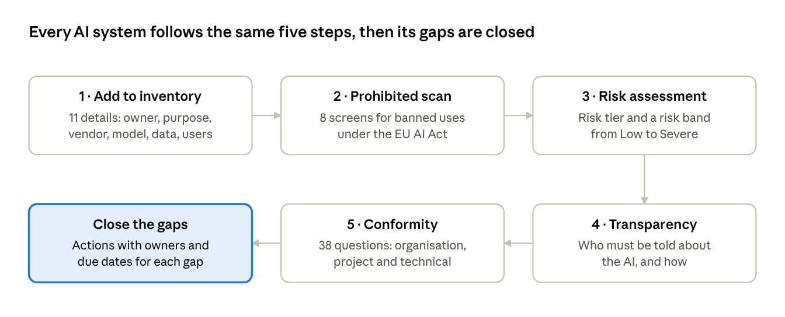

# Ituti AI Assurance: User Guide

Oct 29, 2026 · @Nayan

This guide is for the people who record and assess AI systems: client admins, contributors, viewers and Ituti assessors. It walks through the platform in the order work is done, from adding a system to closing its last gap. Administrators also have an Admin Guide.

## Signing in and finding your way

There are no passwords: you sign in with a link sent to your work email.

1. Open the platform's address (for Ituti's service, assurance.ituti.tech) and enter your email address.
2. Open the email "Your sign-in link for Ituti AI Assurance" and select **Sign in**. The link works once, within 15 minutes, and keeps you signed in for 14 days.
3. New here? Accept the invitation email from your organisation's admin, or, where self-service sign-up is open, register your organisation at `/register`.

If your organisation runs the platform without email, an administrator gives you a one-time sign-in link instead.

**What you see** depends on your role:

| Role | You can |
| --- | --- |
| Client admin | Everything in your organisation: people, teams, systems, assessments, actions |
| Contributor | Edit the AI systems assigned to you; read the rest |
| Viewer | Read everything; edit only what a task gives you |
| Team lead | Edit every system your team covers and hand out tasks |
| Ituti assessor | Assess and edit every system of the clients assigned to you |

**Your organisation's home** is the AI inventory: every system with its business unit, team, owner, EU AI Act tier, risk score, readiness and journey stage, with summary tiles above. The menu across the top leads to **AI inventory**, **Risk management**, **Incident tracker**, **Documents** and **Tasks**, and for admins **Teams**, **People** and **Activity**.

**Pick up where you left off.** The platform remembers the tab and position you were working on in each system; the home page offers **Continue** to return there. Selecting the logo saves any open changes before it takes you home.

## The compliance journey

Every AI system goes through the same five steps. The system's page shows them as tiles with a status each (not started, in progress, done), and a sixth tile, **Close the gaps**, once there is something to fix.

| Step | What you do | What you get |
| --- | --- | --- |
| 1. Inventory | Record the system's 11 key details | A system in your AI inventory |
| 2. Prohibited scan | Answer 8 screens for practices the EU AI Act bans | A clear stop if a use is prohibited |
| 3. Risk assessment | Confirm the classification and the risk factors | A tier (Prohibited, High, Limited, Minimal, Needs legal review) and an inherent risk band (Low, Moderate, Elevated, Severe) |
| 4. Transparency | Say who interacts with the system and what they are told | The transparency obligations that apply |
| 5. Conformity | Work through up to 38 questions | A conformity record and readiness score |

You can do the steps yourself, or let the assessment agent draft them from your evidence and then review what it proposes (see *Evidence and the assessment agent*). Classification is an indication to support your judgement, not legal advice.

## Adding an AI system and its profile

1. On the AI inventory, select **Add AI system** and give it a name. Under the page title you can see your subscription and how many systems it allows: the free plan includes up to 2, Standard up to 10 and Enterprise is unlimited. When you reach the limit, the note there links to Ituti to upgrade.
2. Fill in the eleven inventory details: name, business unit or legal entity, managing team, responsible person, what the system does, lifecycle stage, where it is used, sector, business function, your organisation's role (provider, deployer and so on) and type of AI.
3. Open the **Profile** tab for the rest: where the model comes from, vendor or foundation model, version, data sources, who is affected, data processed, people affected each year, degree of automation and reversibility of a wrong outcome.

Each field has a **Why we ask** note explaining which rule it feeds, for example that the business function decides whether Annex III presumes the system high-risk.

**Saving is automatic.** Changes save 0.8 seconds after you stop typing; the status beside the title reads *Saving…*, *Saved* or *Unsaved changes*. If a colleague saved the same system meanwhile, you are asked to **Keep mine and overwrite** or **Load their version**, so nobody's work disappears silently.

> **Tip:** naming the vendor or foundation model lets the assessment agent look up what the provider publishes about it.

## Evidence and the assessment agent

The **Evidence and agent** tab is where documents go in and drafted answers come out.

**1. Add evidence.** Drag files onto *Drop files here or choose files*. Accepted: PDF, Word (.docx), Excel (.xlsx), CSV, text, Markdown, JSON and HTML, up to 25 MB each. Model cards, DPIAs, validation reports, policies and vendor documentation are the most useful.

**2. Run the agent.** Select **Pre-fill with agent** (later, **Run again**). A crew of specialist agents reads the evidence, researches the model, classifies the system, assesses controls, drafts documentation and conformity answers, and checks every quote against its source. The panel shows each specialist's progress and its cost. A run usually takes a few minutes; you can leave the page and come back.

**3. Review the proposals.** Every answer the agent drafts is a *proposal* with:

- the value it suggests and its confidence;
- the exact quote from your documents that supports it, with the document name;
- its reasoning.

Accept, edit then **Accept edited**, or reject each one. **Accept N high-confidence** accepts all high-confidence proposals at once. Nothing the agent proposes changes the assessment until a person accepts it.

**Review evidence with Claude** asks Claude to read one document and tell you what it supports and what is missing.

> AI assistance is only available when your organisation's admin has switched it on; documents are then sent to Anthropic for processing. Without it, every step can be completed by hand.

## Classification and controls

**Classification** shows the system's EU AI Act tier with the reasons: the prohibited-practice screens, any Annex III use, transparency triggers and exemptions. Tiers are *Prohibited*, *High risk*, *Limited risk*, *Minimal risk*, *Needs legal review* and *Not classified*. Alongside it, the **inherent risk** score combines impact, scale, automation, data and reversibility into a band: Low, Moderate, Elevated or Severe. Changing a profile answer updates both immediately.

**Controls** lists the 39 controls in nine areas that the platform assesses against the EU AI Act, UK expectations (FCA Consumer Duty, SM&CR, PRA SS1/23), ISO/IEC 42001 and the NIST AI RMF:

| Area | Controls |
| --- | --- |
| Governance | 6 |
| Risk management | 5 |
| Data | 5 |
| Documentation | 3 |
| Transparency | 4 |
| Human oversight | 4 |
| Technical robustness | 5 |
| Monitoring | 4 |
| Conformity | 3 |

Twenty controls apply only when the profile makes them relevant, for example generative AI or high risk; the rest always apply. For each control record **Met**, **Partial**, **Not met** or **Not applicable**, with the evidence and a note. **Readiness** is the share of applicable controls that are met, counting a partial as half.

## Conformity assessment

The **Conformity** tab holds up to 38 questions in three groups:

- **Organisational** (5): policies, roles and the quality management system around the system.
- **Project** (18): purpose, data, design choices, testing and human oversight for this system.
- **Technical** (15): accuracy, robustness, security, logging and monitoring.

Answer each one in your own words, or accept the agent's drafted answer with its supporting quote. Questions that do not apply to the system's tier and profile are marked so. When the answers are complete, the conformity record feeds the report and the model card.

## Reports, model card and documents

- **Report** tab: the assessment report for the system, covering classification, inherent risk, controls, gaps and conformity, ready to print or save as PDF.
- **Model card** tab: a plain-language card for the system. Select **Create a public link** to share it outside the platform, and **Revoke** to withdraw the link at any time.
- **Documents** (top menu): every evidence document across your organisation, which system it belongs to, who uploaded it and when.

Reports show the date and version they were produced from, so you can tell which assessment an auditor saw.

## Monitoring and incidents

**Monitoring** tracks the metrics agreed for the system (accuracy, drift, fairness, complaints and so on). Give each metric a threshold and record values over time; each shows *Within threshold*, *Near breach* or *Breach*.

**Incidents** are adverse events involving the system. Record the title, date, severity, category and notes, and whether it is a **reportable serious incident**: serious incidents involving high-risk systems may need reporting to the authority under Article 73 of the EU AI Act. Reportable incidents are flagged on the system and on the organisation's **Incident tracker**, which lists incidents across every system with their owners and due dates.

**Risk management** (top menu) shows the organisation's risk register: each system's tier, inherent risk band and open gaps side by side.

## Action plan, teams and tasks

The **Action plan** tab turns every gap into an action: a control not met, a partial control, an unanswered conformity question. Each action has a suggested fix, an owner, a due date and a status.

- **Automatic actions:** when switched on, actions are raised for new gaps as soon as an assessment changes, and closed when the gap is closed. Turn it off to raise them yourself.
- Assign an owner from your organisation; they see the action under **Tasks** with its due date.

**Teams** groups people and the systems they cover. A team lead can edit every system the team covers and hand out tasks; team members work on the tasks given to them.

**Tasks** (top menu) is each person's to-do list across all systems: actions, review requests and overdue items first.

The system's **Team** tab shows who can work on it and in what role.

## Using from Claude or watsonx Orchestrate

The platform is also an **MCP server**, so you can work with it from Claude (or any MCP client, including IBM watsonx Orchestrate) in plain language.

**Connect Claude:** add a custom connector with the address `https://<your platform address>/api/mcp`. Claude opens the platform's sign-in page; sign in and approve the connection. You act with your own rights: Claude sees only what you can see. Your admin can disconnect it under **Connected AI applications**.

**What you can ask:**

| You ask | Claude uses |
| --- | --- |
| "How many AI systems do we have, and which are high risk?" | list\_systems |
| "Show me everything about the fraud model" | get\_system |
| "Add this vendor document as evidence and start an assessment" | add\_evidence, start\_assessment |
| "How is the assessment going? What did it propose?" | assessment\_status, list\_proposals |
| "What gaps are still open?" | get\_gaps |
| "Log an incident on the chatbot" | report\_incident, list\_incidents |
| "Find where our DPIA mentions retention" | search\_evidence, read\_evidence |
| "What did AI cost us this month?" | get\_ai\_spend |

Assessments are billable, so Claude asks you to confirm before it starts one. Proposals are never accepted through Claude: it gives you a review link and you accept them in the platform.

## Questions and answers

**My sign-in link doesn't work.** Links work once and expire after 15 minutes. Request a new one; if no email arrives, ask your admin for a one-time link.

**The Pre-fill with agent button is greyed out.** AI assistance is off for your organisation, you have not added any evidence, or your organisation has reached its AI budget. The button's note says which.

**The agent proposed something wrong.** Reject it or edit it before accepting. The supporting quote shows where it came from; if the document is outdated, replace it and run again.

**Can I undo an accepted proposal?** Yes: edit the field. The activity log keeps who changed what and when.

**Someone else edited the same system.** You'll be asked whether to keep your changes or load theirs; nothing is overwritten without asking.

**Is the classification legal advice?** No. It is an indication based on your answers; *Needs legal review* means a lawyer should confirm it.

**Who can see our documents?** People in your organisation with access to the system, and Ituti assessors assigned to your organisation. Documents go to Anthropic only when AI assistance is on.
